

  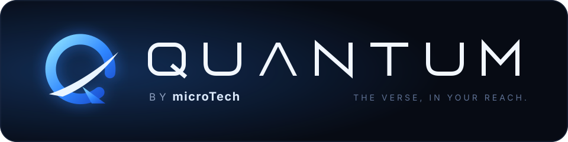

# Quantum

**Star Citizen companion app for Windows** with a live 3D map, route planner, contract tracker, live ship and player stats, trade and fleet tools, daily jobs, player marketplace, org tools, friends management, messaging, and patch update information all in one app.

  <a href="https://quantumsc.org/media/Quantum-Demo.mp4">▶ Watch the demo</a>  

<table>
  <tr>
    <td><a href="images/3D-Cities.png">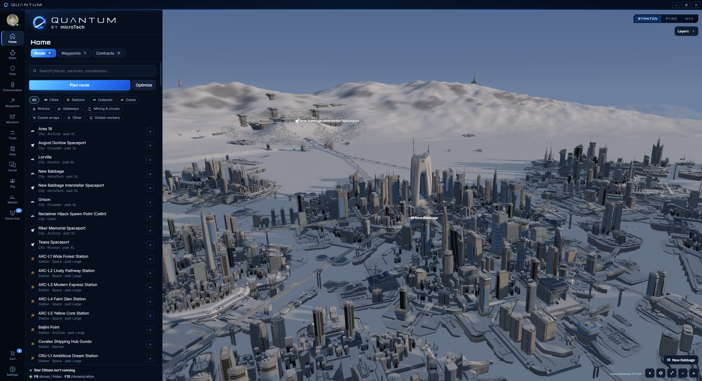</a></td>
    <td><a href="images/FleetManagement.png">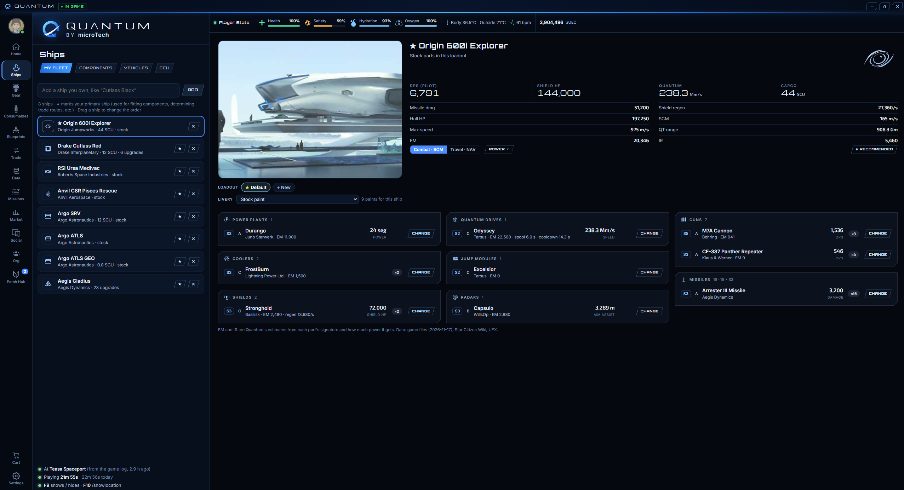</a></td>
    <td><a href="images/RoutePlanning.png">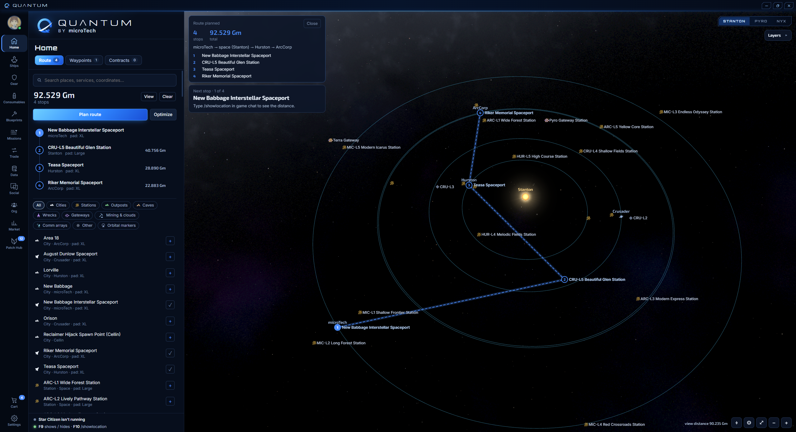</a></td>
  </tr>
</table>

> **Fan project.** Quantum is unofficial and not affiliated with or endorsed by Cloud Imperium Games. It never changes game files or memory. It reads `Game.log`, your clipboard and the game's own local telemetry stream (read-only, on this PC only), and, only when you ask, types `/showlocation` into chat and screenshots the game window for price reports.

> **Early development.** Quantum is updated often and some features are still rough. Found a bug or have an idea? Use **Settings → Send a report**.

## Download

Get `Quantum.exe` from [Releases](https://github.com/Sammmy1036/Quantum/releases/latest). Windows 10 or 11. Quantum updates itself and only installs releases signed with its release key.

## What it does

The sections below follow the left rail. You can drag the rail's buttons into any order you like, and Quantum remembers it.

| | |
|---|---|
| **Home** | 3D map of Stanton, Pyro and Nyx with 3D cities and stations, drawn with the game's own map symbols. Shows where you are from `/showlocation` and the game log and follows you as you fly, even between `/showlocation`s and through quantum jumps. With game telemetry on, your dot becomes your current ship. Plan multi-stop routes across systems, save **Waypoints** with any icon, and get guided to each stop. Place cards show local time, services and the way to get there. |
| **Contracts** | Hauling contracts are picked up from the game log and pinned on the map, pickups listed first, with a tracker for each one. Gaps in mission text, like a bounty's target and location, are filled in. |
| **Onyx Facilities** | Overhead floor plans for every Onyx Facility, built from the game's own layout: each wing and storey with walls, doors, lifts and enemy spawns. A `/showlocation` inside puts you on the right floor and draws the way out. |
| **Ships** | Every vehicle and component with stats read from the game files, paints for each generation, and where to buy them, sorted by cheapest or closest to you. **My Fleet** keeps your ships with up to 5 loadouts each. **Compare** shows only what's different between two ships. **Upgrades (CCU)** finds the cheapest upgrade chain from the ship you have to the one you want, or points you to The Impound when none is on sale. |
| **Gear** | Weapons, armor, clothing, gadgets and attachments, with **Where to find it** for loot (Contested Zones, bunkers, Distribution Centres, wrecks) and the nearest places to go. Fit attachments to each weapon, compare any two items, and save your own gear loadouts for each kind of job. |
| **Consumables** | Search for any consumables such as food, drink, medical, and keys. |
| **Blueprints** | Crafting blueprints: what each one makes, what it needs and where to get it. |
| **Trade** | Commodity prices, where mined resources are found, and ranked trade routes for your ship and budget, using UEX and Quantum's own fresh reports (prices under a day old only). Track each run from Planned to Sold, see a 3D **load plan** of how your cargo fits your ship's grids, and set price alerts on any commodity. |
| **Data** | The datarunner program: report terminal prices to UEX from inside Quantum, hold up to 5 jobs at a time, and climb the leaderboard. |
| **Missions** | Who hands out contracts, the factions behind them and what each offers. **Jobs** gives you daily goals for every role (hauling, deliveries, bounties, mercenary work, salvage, mining, refueling, trading) and weekly missions that mix several roles, counted from your aUEC earnings. Pick a preferred role, pin up to 3 jobs to the map, earn Job Points and Bronze to Diamond badges for your profile. |
| **Market** | Buy and sell items and services with other players, **aUEC only**. Rate each other after a trade and see anyone's rating and trust badges. Optional escrow for trades of 1,000,000 aUEC or more. Price alerts for gear, weapons and items. |
| **Social** | Friends, messages and online status. Right-click a friend to open their profile, message them, see their ships and more. The **Friend Map** shows friends and org mates who share their location, on the map. |
| **Org** | Your org's members, ranks with icons, banner, an About page with formatting, calendar, events with crew seats, and invites. Add your own entries to the calendar too, with a place on the map and a reminder. Your calendar follows you to any PC. Orgs verified with RSI are listed in Find orgs and link to their RSI page. |
| **Patch Hub** | Dedicated section for ongoing and upcoming events in Star Citizen, along with patch notes, new ships, gear, twitch drops, with links to official RSI information where the data was obtained. |
| **Cart** | Put anything you want to buy in one cart, and Quantum plans the fewest stops to buy it all. Click an item to open its page; items you can only loot or craft aren't added. Heart any ship, part or gear to add it to your **wish list** (synced with your account), then send it to the Cart in one click. |
| **Profile** | Your fleet, loadouts, orgs, listings, ratings, job badges and datarunner stats, with control over what others see. Click a name on the leaderboard to open their profile. |

<table>
  <tr>
    <td><a href="images/Vehicles.png">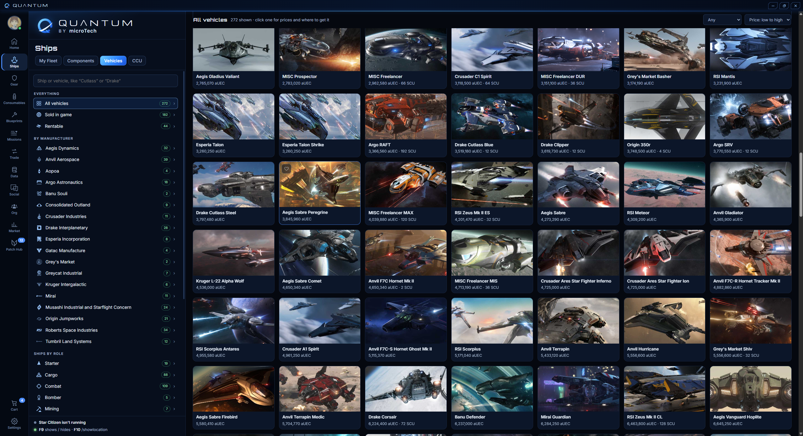</a></td>
    <td><a href="images/Vehicles2.png">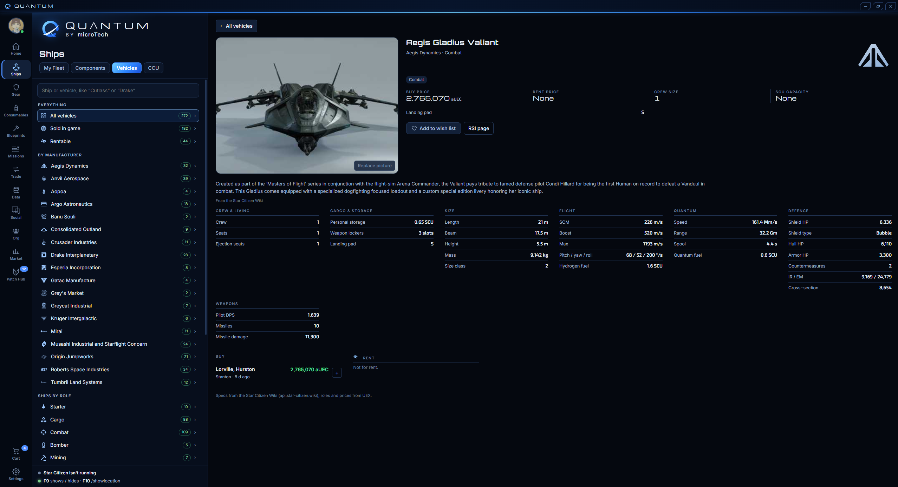</a></td>
    <td><a href="images/Gear.png">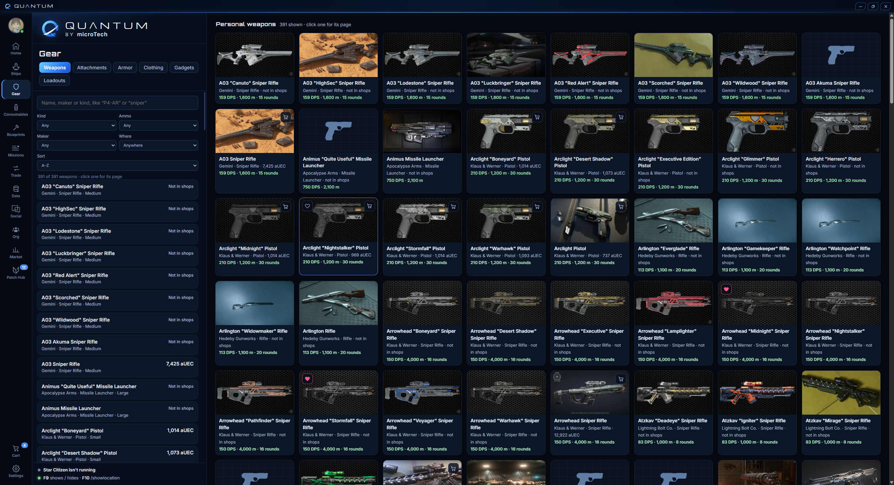</a></td>
  </tr>
  <tr>
    <td><a href="images/CCU.png">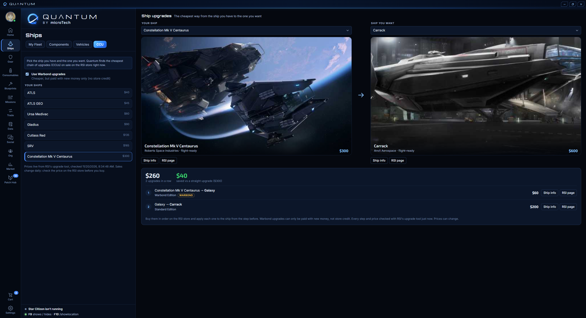</a></td>
    <td><a href="images/Attachments.png">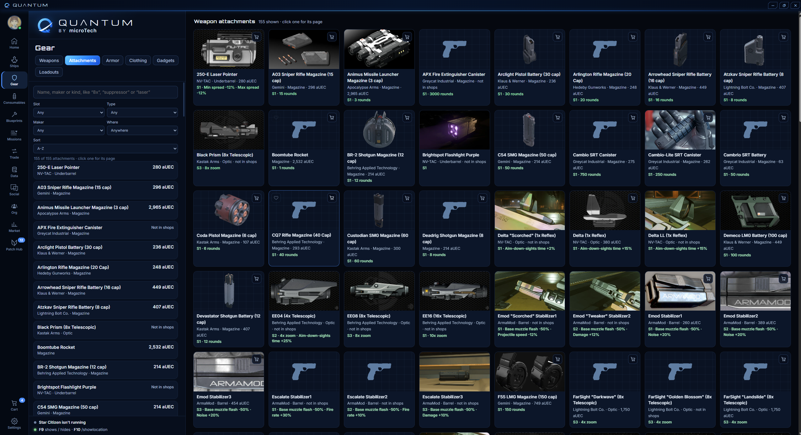</a></td>
    <td><a href="images/Blueprints.png">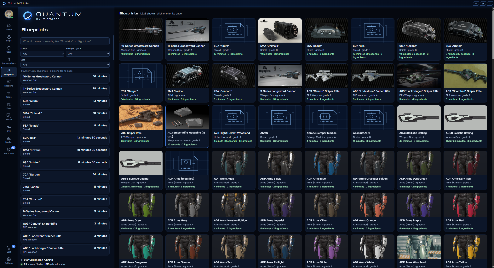</a></td>
  </tr>
  <tr>
    <td><a href="images/TradeRoutes.png">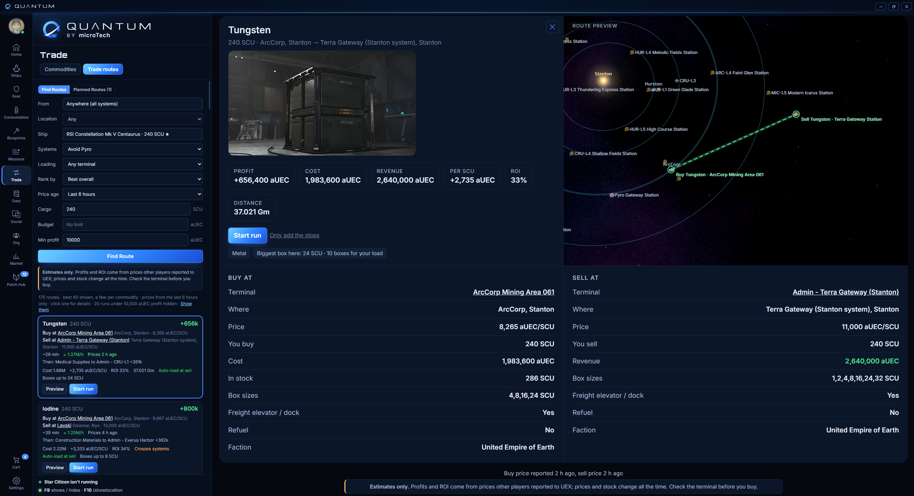</a></td>
    <td><a href="images/Commodities.png">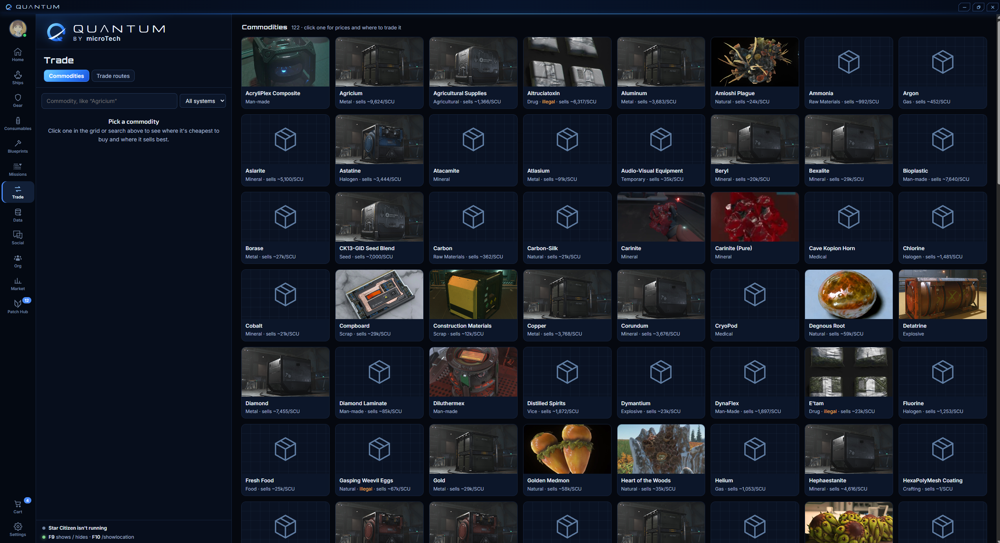</a></td>
    <td><a href="images/Wishlists.png">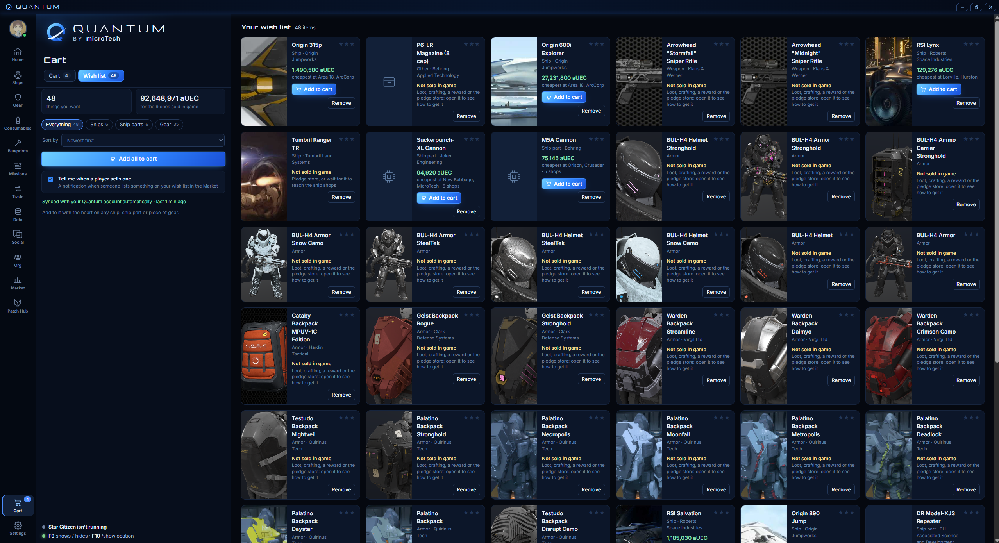</a></td>
  </tr>
</table>

## Live game info

**Game telemetry** is on by default (**Settings → Game telemetry**). Star Citizen streams your ship's and character's state on your own PC, and Quantum only listens to it. It adds:

- **Player Stats bar:** health, satiety, hydration, oxygen, body and outside temperature, heart rate and your aUEC balance, on any edge of the window and on every page. Drag the items to reorder them.
- **Ship card on the map:** speed, fuel, shields, hull, warning lights and NAV/SCM mode.
- **Alerts** the moment you're downed, killed or respawn, and a warning when a possible threat shows up near you.

The game's telemetry isn't documented by CIG and can change with any patch. If it's off or unavailable, everything still works from `Game.log` and `/showlocation`.

## Overlays

Overlays show over the game and need Borderless or Windowed mode.

- **Location clock:** when you land or spawn in a city, it shows the city's name and local time. Choose how long it stays, where it sits and how big it is.
- **Navigation Guide:** an arrow, compass or heading tape pointing to your next stop, with that stop's icon. It shows only while you're in atmosphere. Drag it anywhere (it snaps to the centre), and set its look, colour and size under **Settings → Game telemetry**.

## Getting set up

1. **Create a free Quantum account** at [quantumsc.org](https://quantumsc.org/account/signup) and confirm your email. You choose your **username** at sign-up. It's your one name everywhere in Quantum and it's permanent. Then sign in from the app by clicking the picture at the top of the left bar.
2. **Add your UEX keys** (needed for Trade, Ships, backups and datarunning): in [UEX](https://uexcorp.space/api/apps), create an app and copy its **Bearer Token**. Paste it under **Profile → Linked accounts**. To report prices, also add your **UEX Secret Key** from your UEX profile.

The map, routes, contracts, gear, blueprints, telemetry and overlays work without any account. **Sending anything to Quantum's community server** (price reports, pictures, station positions, alignments, jobs, messages, listings, org changes) **needs a Quantum account with your UEX name linked.** Signing in with only a UEX key no longer works.

## In game

| Key | What it does |
|---|---|
| **F9** | Show or hide Quantum over the game |
| **F10** | Types `/showlocation` so the map knows exactly where you are |
| **Screenshot key** | Screenshots a kiosk for a price report (set it in Settings) |
| **Anti-AFK key** | Optional, off by default. Turns Anti-AFK on or off: every 1 to 4 minutes it sends a 1-pixel mouse nudge (or F13, a key the game doesn't use). Set it up in **Settings → Hotkeys**. Use it at your own discretion. |

All keys can be changed in **Settings**. If Star Citizen runs as administrator, Quantum must too (Settings has a button for it). When the game isn't running, the **Start Launcher** button beside the status line opens the RSI Launcher (you can hide it in Settings).

## Make it yours

- **Button style:** pick Classic, HUD Chamfer (the default), RSI Launcher Outline, Angled or Bracketed Glass, with a preview of each, in **Settings**.
- **Title bar:** Quantum uses its own microTech HUD title bar. Settings can switch it back to the normal Windows one.
- **Rail order:** drag the left rail's sections into any order.
- **3D city weather:** snow, rain, haze and dust are off by default and can be turned on in Settings.

## Social, Market and Orgs

These need a Quantum account.

- **Profiles:** click anyone's name in Social, the Market or an org to see their profile. Choose who can see yours (everyone, friends or only you) and what it shows under **Profile → Profile privacy**.
- **Friend Map:** your location is shared only when you turn it on, and only with friends and org mates.
- **Market:** listings are **aUEC only**. Real-money trades break Star Citizen's Terms of Service and get listings taken down. Quantum doesn't take part in trades. Escrow agents are volunteer players, and the escrow fee goes to them. After a trade, both sides can leave a rating and a review; **Your standing** in My market shows how others see you. Report a listing with the ⚑ button.
- **Orgs:** anyone can create an org. To be listed in Find orgs, an org must be **verified with RSI**: use your RSI org's SID as the tag, put the code Quantum gives you on your RSI org page, then press **Check now**. You can set an org to Private in its Settings. The About page takes plain text or simple HTML (headings, lists, colours, pictures); scripts and anything unsafe are removed, and links and pictures from any site are for verified orgs only.

## Community server rules

Quantum's code is free to use, change and share under the MIT License. The community server at quantumsc.org is a separate free service, and the MIT License gives no right to use it. Its [Terms of Use](https://quantumsc.org/terms) and the **"The Quantum community server"** section of the [LICENSE](LICENSE.txt) say:

- **Official releases only.** Only unmodified releases from this repo's [Releases](https://github.com/Sammmy1036/Quantum/releases) may connect. If you build your own version, point it at your own server with the `community_url` setting, or set `"community_url": "off"`.
- **Account required.** Sending anything to the server needs a Quantum account with your UEX name linked. One person, one account.
- **No scraping or automated access** without written permission.
- **Enforcement.** The server checks which build of Quantum is connecting. Builds and accounts that break these rules can be refused, suspended or banned.

## Backups

With a UEX Bearer Token, Quantum backs up your fleet, loadouts, waypoints, trade routes and mapped stations automatically. The backup is locked with your token on your PC, so nobody else can read it, not even the server. On a new PC, enter the same token and everything comes back. Your wish list, calendar, jobs and session stats are kept with your Quantum account, so they follow you too.

## Privacy

Quantum keeps your keys and data on your PC unless you choose otherwise, and the server keeps only what's needed for the features you use. A few things are worth knowing:

- **Which build you're using.** The app sends its version and a fingerprint of the program, so the server can tell official releases from modified copies. It identifies the program, never you or your PC.
- **Game telemetry** is read on your PC only. While you're signed in, your session stats and aUEC balance changes are synced with your account so Jobs can count them and your stats survive updates and new PCs. Signed out, they stay on your PC.
- **Your location** goes to the server only while you share it on the Friend Map.
- **Price report screenshots** are kept for **14 days** so reports can be reviewed, then deleted.
- **Emails** the server sends you are logged (address, subject, whether it was delivered, and a copy with every sign-in link removed) for **30 days**. Emails with the moderation team are kept for up to a year.

The full details are in the [privacy policy](https://quantumsc.org/privacy) and the [Terms of Use](https://quantumsc.org/terms). You can download or delete everything your account holds from [your account page](https://quantumsc.org/account?tab=security). To run Quantum without any community features, use **Settings → Disable community features**.

## Credits

- **[UEX Corp](https://uexcorp.space):** prices, trade data, vehicles, items and the datarunner program
- **[Star Citizen Wiki](https://starcitizen.tools)** and its **[API](https://api.star-citizen.wiki):** ships, gear, blueprints, missions, upgrade prices and pictures
- **[Valalol / Star-Citizen-Navigation](https://github.com/Valalol/Star-Citizen-Navigation)** and **[starnav](https://crates.io/crates/starnav):** navigation data
- **[unp4k](https://github.com/dolkensp/unp4k):** game-file extraction for ship, component, gear, contract, map symbol and Onyx Facility data
- **Quantum datarunners:** the prices, station positions and pictures they share

Quantum's code is under the [MIT License](LICENSE.txt), which also lists third-party code and data and the rules for the community server. See [Releases](https://github.com/Sammmy1036/Quantum/releases) for what's new in each version.

Star Citizen®, Roberts Space Industries® and Cloud Imperium® are registered trademarks of Cloud Imperium Rights LLC. microTech is a fictional in-game company; its name is used in the spirit of the game.
